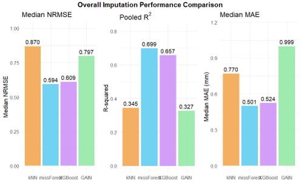
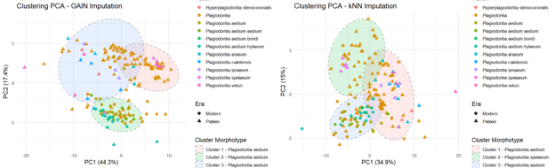

# 04-Missing-Data-Imputation

## Overview

Missing data are a common challenge in palaeontological and
morphometric datasets because fossil specimens are frequently
incomplete or damaged.

This project investigated how different missing-data imputation
methods affect both numerical reconstruction and downstream
biological interpretation using morphometric measurements from
Hispaniolan hutias.

Four approaches were compared:

- k-Nearest Neighbours (KNN)
- missForest
- XGBoost
- Generative Adversarial Imputation Nets (GAIN)

Imputation quality was evaluated using reconstruction metrics and
by examining its effects on PCA, clustering, and taxonomic
interpretation.

## My Contribution

This project was completed as part of a group study comparing four
missing-data imputation approaches: KNN, missForest, XGBoost, and
Generative Adversarial Imputation Nets (GAIN).

My primary implementation contribution focused on the **GAIN
imputation pipeline**, including data preparation for neural-network
imputation, model execution and evaluation of the resulting imputed
data.

The repository contains the surviving code and materials from my
individual contribution. Results from the other imputation methods
are included in the project summary to provide context for the
comparative study, but their original implementation code is not
included.

## Dataset

The dataset contained **79 specimens and 168 variables**, including
cranial, mandibular, and dental morphometric measurements alongside
metadata describing taxonomy, geological era, and geographic origin.

Exploratory analysis examined both the extent and potential mechanism
of missingness before applying imputation.

## Missingness Analysis

Exploratory analysis indicated that missingness was associated with
observable specimen characteristics.

- Missingness differed significantly between palaeo and modern
  specimens (p < 2 × 10⁻¹⁶).
- Little's MCAR test returned p = 0.0268, providing evidence against
  Missing Completely at Random (MCAR).

Based on these results and the biological characteristics of the
dataset, Missing at Random (MAR) was used as a working assumption.

## GAIN Imputation

My implementation contribution focused on **Generative Adversarial
Imputation Nets (GAIN)**, a deep-learning approach that uses an
adversarial framework to learn the underlying multivariate
distribution and estimate missing values.

Continuous variables were min-max normalised to the [0, 1] range
before training. A proportion of observed values was artificially
masked to allow imputation performance to be evaluated against known
values.

Training required an adaptive strategy because model convergence was
unstable for this relatively small, high-dimensional dataset.

## Key Results

| Method | Median NRMSE | Pooled R² | Median MAE |
|---|---:|---:|---:|
| KNN | 0.870 | 0.345 | 0.770 |
| missForest | **0.594** | **0.699** | **0.501** |
| XGBoost | 0.609 | 0.657 | 0.524 |
| GAIN | 0.797 | 0.327 | 0.999 |

Tree-based methods produced the strongest imputation performance.
missForest achieved the lowest median NRMSE and MAE and the highest
pooled R².

GAIN, despite being the most complex approach evaluated, produced
higher reconstruction error and poorer preservation of multivariate
relationships.

The result demonstrates an important practical lesson: **greater model
complexity does not necessarily translate into better performance,
particularly for small biological datasets.**

## Impact on Biological Interpretation

Imputation quality affected downstream taxonomic analysis.

PCA and clustering performed on the imputed datasets revealed
substantial differences in morphological separation between methods.

Tree-based methods preserved clearer taxonomic structure, while the
GAIN-imputed dataset exhibited greater cluster overlap.

This demonstrates that missing-data imputation is not simply a
preprocessing decision: the selected method can directly influence
the biological conclusions drawn from incomplete data.
